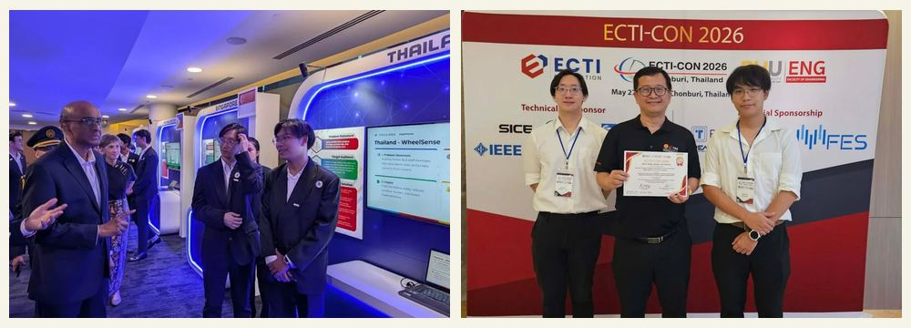
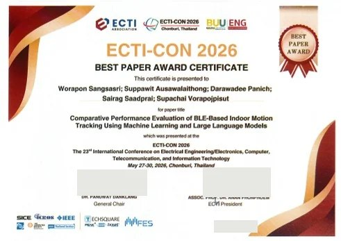

# Worapon Sangsasri · Knight

**Applications Engineer at TECHSQUARE · LabVIEW · Embedded AI for Assistive Technology**

I build systems that turn signals from hardware into something people can act on. At TECHSQUARE, I build LabVIEW demos and help customers get started with their applications. In research, I build and evaluate connected sensing systems for assistive technology.

[Portfolio ↗](https://nnoppons.github.io/) · [CV ↗](https://nnoppons.github.io/cv.html) · [Photos & certificates ↗](https://nnoppons.github.io/evidence/) · [LinkedIn ↗](https://www.linkedin.com/in/worapon-sangsasri-0371a8376/) · [Email](mailto:worapon.sangs@gmail.com)

## Selected work

**01 / WheelSense & EaseAI** · Assistive technology  
WheelSense began as a home prototype for wheelchair users, with indoor tracking, reminders, appliance controls, and exercise suggestions. EaseAI extended it into a caregiver workflow prototype for nursing homes. I worked across embedded sensing, firmware, mobile, and backend.  
[Engineering case study ↗](https://nnoppons.github.io/wheelsense/) · [Source code ↗](https://github.com/NnopponS/WheelSense_Project)

**02 / WheelAthlete** · Research instrumentation  
Synchronized left and right wheel IMUs feed a Windows workflow for recording wheelchair motion, checking data quality, and exporting datasets. Acquisition stays separate from the desktop interface, so live recording does not depend on charts or analysis.  
[Engineering case study ↗](https://nnoppons.github.io/wheelathlete/) · [Source code ↗](https://github.com/NnopponS/WheelAthelse) · [Releases ↗](https://github.com/NnopponS/WheelAthelse/releases)

**03 / Indoor motion tracking** · First-author research  
At Thammasat University's CED2 research center, I compared machine learning and large language models for indoor motion tracking using Bluetooth Low Energy signal data. The work received Best Paper at ECTI-CON 2026.  
[Read the IEEE paper ↗](https://ieeexplore.ieee.org/document/11608653) · [Best Paper certificate preview ↗](https://nnoppons.github.io/evidence/#ecticon-best-paper-cert)

## Field evidence

*Singapore, AI Ready ASEAN regional showcase (left) · ECTI-CON 2026, Best Paper recognition (right).*

<strong>Open a real certificate preview</strong>

 

[View the privacy-edited award record in the archive ↗](https://nnoppons.github.io/evidence/#ecticon-best-paper-cert)

<strong>See the InnoServe stage photo</strong>

 

*InnoServe Awards 2026, Taipei · 3rd place, International Exchange (English).*

- **Thailand:** 1st at LabVIEW Battle, 4th nationwide at TESA Top Gun; Gold, category winner and Popular Vote at I-New Gen; HIC Merit Award; 1st place at the TESAIoT Service Robotics Hackathon for EaseAI.
- **International:** Represented Thailand at AI Ready ASEAN in Singapore, earned Gold and a Special Award in Shanghai, and placed 3rd at InnoServe in Taipei with WheelSense.
- **Personal recognition:** Quality Youths Scholarship of the Year.

[Recognition timeline ↗](https://nnoppons.github.io/#awards) · [2026 competition recap ↗](https://www.linkedin.com/feed/update/urn:li:activity:7531009753288691712/)

## More from my workbench

[agent-doctor](https://github.com/NnopponS/agent-doctor) · [ReachSenseAI](https://github.com/NnopponS/ReachSenseAI) · [DroneDetector](https://github.com/NnopponS/DroneDetector) · [100-games](https://github.com/NnopponS/100-games)

**Tools I work with:** LabVIEW, C/C++, ESP32, BLE, Python, FastAPI, React, Flutter, and PostgreSQL.
