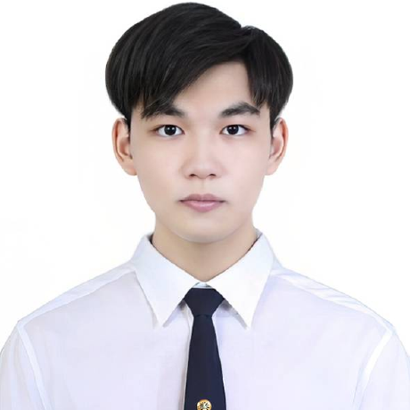
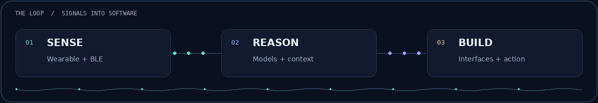
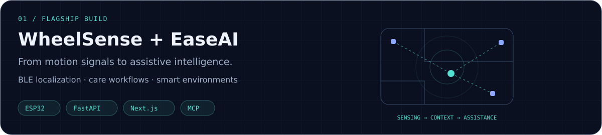
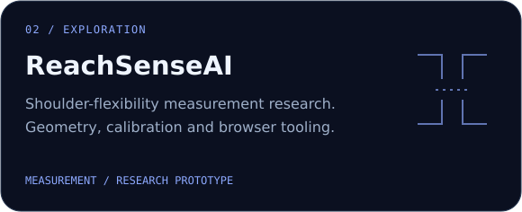
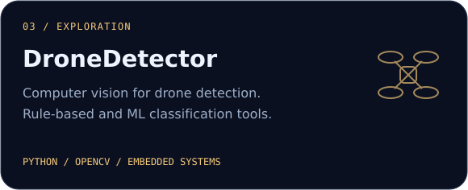
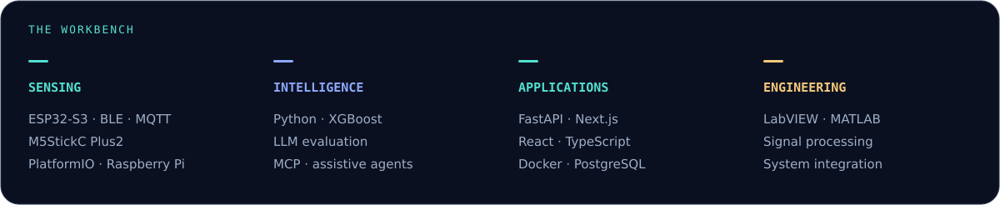
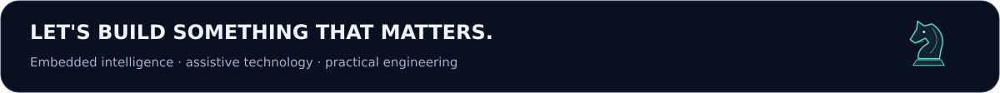

  <picture>
    <source media="(max-width: 600px)" srcset="./assets/hero-mobile.svg" />
    
  </picture>

  
  &nbsp;
  
  &nbsp;
  

### Hey, I'm Knight 👋

I'm **Worapon Sangsasri**, an electrical engineering researcher and developer in Thailand, focused on **Embedded AI, AIoT, and assistive technology**.

I work across the whole system: wearable sensing, BLE localization, AI models, backend services, and the interfaces people actually use. My flagship work is **WheelSense**, with the **EaseAI** assistive layer for elderly care and wheelchair users.

🎓 **Thammasat University** · Electrical Engineering · GPA **3.72**  
🔬 **Research:** BLE motion tracking, machine learning, and LLM evaluation  
🛠️ **I enjoy:** connecting hardware and software, then testing what works

 

<picture>
  <source media="(prefers-reduced-motion: reduce)" srcset="./assets/signal-still.svg" />
  
</picture>

## Selected builds

**[WheelSense source ↗](https://github.com/NnopponS/WheelSense_Project)** · An assistive-care platform connecting motion sensing, caregiver dashboards, smart-home control, and AI assistance.

<table>
  <tr>
    <td width="50%" valign="top">
      
      
<a href="https://github.com/NnopponS/ReachSenseAI"><strong>Explore ReachSenseAI ↗</strong></a> Research prototype; physical validation remains in progress.

    </td>
    <td width="50%" valign="top">
      
      
<a href="https://github.com/NnopponS/DroneDetector"><strong>Explore DroneDetector ↗</strong></a> Computer vision, detection pipelines, and classifier experiments.

    </td>
  </tr>
</table>

## Research & recognition

**First author · ECTI-CON 2026**  
*Comparative Performance Evaluation of BLE-Based Indoor Motion Tracking Using Machine Learning and Large Language Models* — **Best Paper Award**.

My research compares classical ML and LLM approaches on BLE/RSSI motion tasks using **ESP32-S3 anchors** and an **M5StickC Plus2 wearable tag**.

| Year | Recognition | Work |
| :--- | :--- | :--- |
| 2026 | 🏆 **Thailand National Winner** · AI Ready ASEAN Youth Challenge | WheelSense |
| 2026 | 🥇 **Grand Prize + Gold Medal + Popular Vote** · Thailand New Gen Inventors Award | WheelSense |
| 2026 | 🌏 **Gold Medal + Special Award** · China (Shanghai) International Invention & Innovation Expo | WheelSense |
| 2026 | ✨ **Honorable Award, AI Student Division** · Best AI Awards, Taiwan | EaseAI / WheelSense |
| 2025 | 🏆 **Champion** · LabVIEW Battle Thailand | Engineering problem solving |
| 2025 | 🚀 **4th place nationwide, Team Witz** · TESA Top Gun Rally | Embedded systems |

More context and award details: <a href="https://www.linkedin.com/in/worapon-sangsasri-0371a8376/">LinkedIn</a> · <a href="https://NnopponS.github.io/#awards">Portfolio</a>

## My engineering workbench

<picture>
  <source media="(max-width: 600px)" srcset="./assets/stack-mobile.svg" />
  
</picture>

<strong>Open the toolbox — text version</strong>

| Area | Tools & interests |
| :--- | :--- |
| Sensing & embedded | ESP32-S3, M5StickC Plus2, BLE, MQTT, PlatformIO, Raspberry Pi |
| AI & intelligence | Python, XGBoost, LLM evaluation, MCP, assistive agents |
| Applications | FastAPI, Next.js, React, TypeScript, Docker, PostgreSQL |
| Engineering | LabVIEW, MATLAB, signal processing, system integration |

## Let's connect

I'm interested in conversations about **embedded intelligence, AI HealthTech, assistive systems, and applied research**. If you're building where hardware meets useful software, let's talk.

**[LinkedIn](https://www.linkedin.com/in/worapon-sangsasri-0371a8376/)** · **[Portfolio](https://NnopponS.github.io/)** · **[Email](mailto:worapon.sangs@gmail.com)**

Original SVG components + GIF · <a href="./ASSETS.md">Visual sources & customization</a> · Inspired by <a href="https://github.com/abhisheknaiidu/awesome-github-profile-readme">Awesome GitHub Profile README</a>
