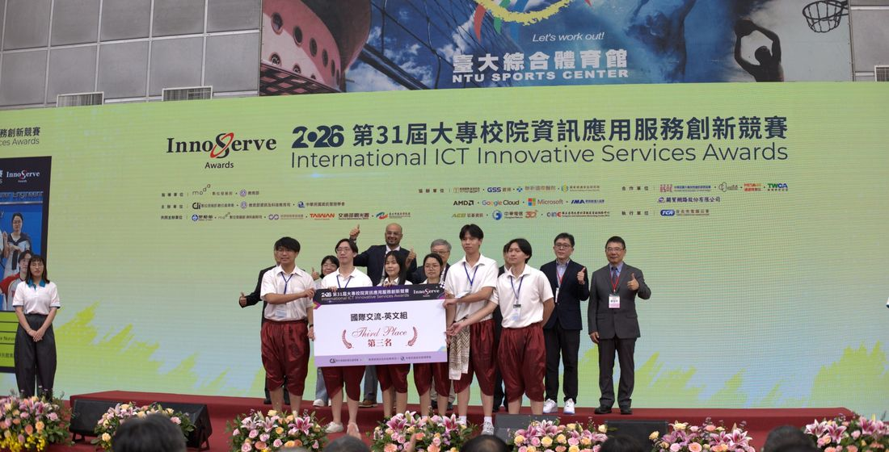
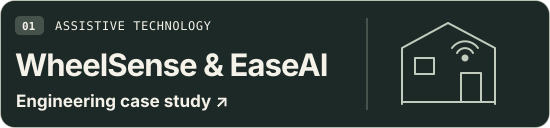
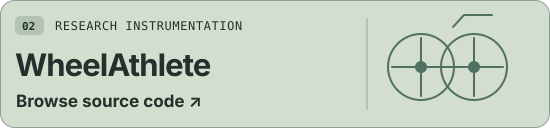
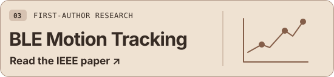

# Worapon Sangsasri · Knight

**Applications Engineer at TECHSQUARE · LabVIEW · Embedded AI for Assistive Technology**

I build systems that turn signals from hardware into something people can act on. At TECHSQUARE, I build LabVIEW demos and help customers get started with their applications. In research, I build and evaluate connected sensing systems for assistive technology.

  &nbsp;
  &nbsp;
  

[Read my 2026 competition recap on LinkedIn ↗](https://www.linkedin.com/feed/update/urn:li:activity:7531009753288691712/)

*InnoServe Awards 2026, Taipei · 3rd place, International Exchange (English).*

## Selected work

### 01 / WheelSense & EaseAI · Assistive technology

WheelSense started as a home prototype for wheelchair users, with indoor tracking, reminders, appliance controls, and exercise suggestions. EaseAI extended that work into a caregiver workflow prototype for nursing homes. I worked across embedded sensing, firmware, mobile, and backend.

[Engineering case study](https://nnoppons.github.io/wheelsense/) · [Source code](https://github.com/NnopponS/WheelSense_Project)

### 02 / WheelAthlete · Research instrumentation

Synchronized left and right wheel IMUs feed a Windows workflow for recording wheelchair motion, checking data quality, and exporting datasets. The acquisition process is separated from the desktop interface to keep live recording independent of charts and analysis.

[Source code](https://github.com/NnopponS/WheelAthelse) · [Releases](https://github.com/NnopponS/WheelAthelse/releases)

### 03 / Indoor motion tracking · First-author research

At Thammasat University's CED2 research center, I compared machine learning and large language models for indoor motion tracking from Bluetooth Low Energy signal data. This work received Best Paper at ECTI-CON 2026.

[Read the IEEE paper](https://ieeexplore.ieee.org/document/11608653)

## How I got here

- **2025 / LabVIEW Battle Thailand → TESA Top Gun Rally.** My team placed first at LabVIEW Battle and fourth nationwide at Top Gun. That's where I found I liked building both the embedded and application sides of a system.
- **2026 / Building WheelSense and EaseAI.** WheelSense earned Gold, the category win, and Popular Vote at I-New Gen, and a Merit Award at HIC Thailand. EaseAI took first at the TESAIoT Service Robotics Hackathon.
- **2026 / Showing our work abroad.** We represented Thailand at AI Ready ASEAN in Singapore, took Gold and a Special Award in Shanghai, and placed third at InnoServe in Taipei. I also received the Quality Youths Scholarship of the Year in Thailand.

[See the full recognition timeline](https://nnoppons.github.io/#awards)

## More from my workbench

[agent-doctor](https://github.com/NnopponS/agent-doctor) · [ReachSenseAI](https://github.com/NnopponS/ReachSenseAI) · [DroneDetector](https://github.com/NnopponS/DroneDetector) · [100-games](https://github.com/NnopponS/100-games)

**Tools I work with:** LabVIEW, C/C++, ESP32, BLE, Python, FastAPI, React, Flutter, and PostgreSQL.
