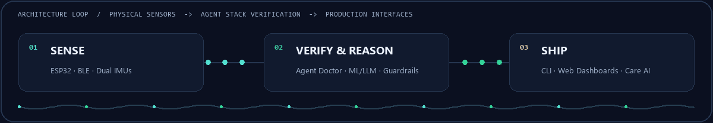
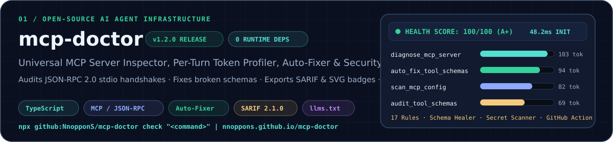
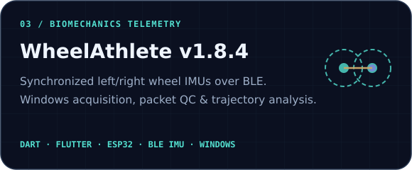
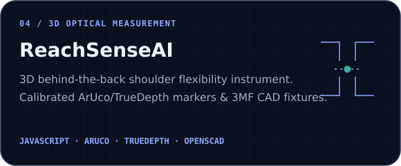
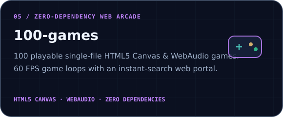
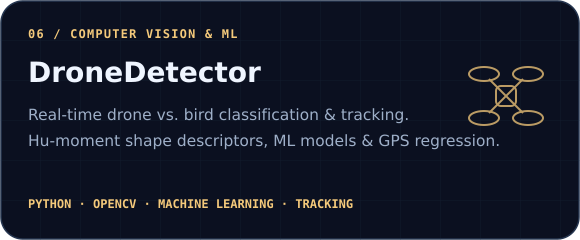
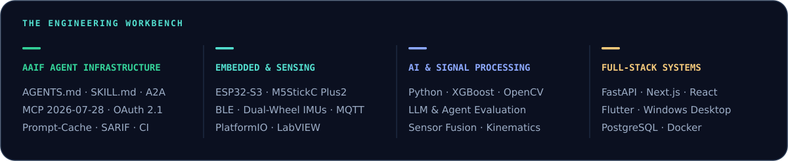
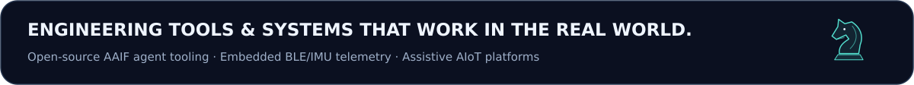

  <picture>
    <source media="(max-width: 600px)" srcset="./assets/hero-mobile.svg" />
    
  </picture>

  
  &nbsp;
  
  &nbsp;
  

### Systems That Bridge Physical Sensors, AI Agents & Developer Tooling

I'm **Worapon (Knight) Sangsasri**, an **AI & Embedded Systems Engineer** in Bangkok, Thailand. I build local-first developer tools, Model Context Protocol (MCP) infrastructure, and end-to-end sensor-to-AI platforms.

My work spans the full stack between hardware and autonomous software:
- **Developer & Agent Infrastructure:** Building **[mcp-doctor](https://github.com/NnopponS/mcp-doctor)** (`v1.2.0`) to audit JSON-RPC 2.0 handshakes, profile per-turn BPE token taxes, auto-fix broken tool schemas, and export SARIF security reports for Claude Code, Cursor, and Codex.
- **Assistive Robotics & Telemetry:** Architecting **[WheelSense](https://github.com/NnopponS/WheelSense_Project)** and **[WheelAthlete](https://github.com/NnopponS/WheelAthelse)** across ESP32-S3 BLE/MQTT gateways, synchronized dual-wheel IMUs, FastAPI backends, and clinical dashboards.
- **Empirical Verification:** Every tool and firmware pipeline I ship is backed by deterministic tests, measured latency/token numbers, and reproducible hardware or protocol checks.

 

<picture>
  <source media="(prefers-reduced-motion: reduce)" srcset="./assets/signal-still.svg" />
   02 Verify & Reason (MCP Doctor, ML/LLM, Guardrails) -> 03 Ship (CLI, Web Dashboards, Care AI)." />
</picture>

---

## Flagship Open-Source & Systems Builds

**[mcp-doctor Repository ↗](https://github.com/NnopponS/mcp-doctor)** · **[Interactive Web Playground & Docs ↗](https://nnoppons.github.io/mcp-doctor/)** · **[v1.2.0 Release ↗](https://github.com/NnopponS/mcp-doctor/releases)**  
Zero-dependency CLI, local Web Dashboard, GitHub Action, and self-hosted MCP server that profiles context-window token tax, repairs broken JSON Schemas (`mcp-doctor fix`), scans MCP configs for leaked API keys, and exports SARIF 2.1.0 + SVG health badges.

 

**[WheelSense Platform Source ↗](https://github.com/NnopponS/WheelSense_Project)** · End-to-end assistive-care and wheelchair monitoring platform integrating ESP32 BLE/MQTT gateways, room-level localization, FastAPI + PostgreSQL services, and role-based Next.js dashboards.

<table>
  <tr>
    <td width="50%" valign="top">
      
      
<a href="https://github.com/NnopponS/WheelAthelse"><strong>WheelAthlete v1.8.4 ↗</strong></a> · <a href="https://github.com/NnopponS/WheelAthelse/releases"><strong>Releases ↗</strong></a> Synchronized dual-wheel BLE IMU acquisition, packet quality control, and offline trajectory analysis for Windows.

    </td>
    <td width="50%" valign="top">
      
      
<a href="https://github.com/NnopponS/ReachSenseAI"><strong>ReachSenseAI ↗</strong></a> · <a href="https://nnoppons.github.io/ReachSenseAI/"><strong>Web Workbench ↗</strong></a> 3D behind-the-back shoulder flexibility measurement instrument with calibrated optical markers and printable 3MF fixtures.

    </td>
  </tr>
  <tr>
    <td width="50%" valign="top">
      
      
<a href="https://github.com/NnopponS/100-games"><strong>100-games Source ↗</strong></a> · <a href="https://nnoppons.github.io/100-games/"><strong>Play Live Arcade ↗</strong></a> 100 self-contained HTML5 Canvas and procedural WebAudio arcade games with a unified instant-search portal.

    </td>
    <td width="50%" valign="top">
      
      
<a href="https://github.com/NnopponS/DroneDetector"><strong>DroneDetector ↗</strong></a> Computer-vision pipeline for real-time drone vs. bird classification, multi-frame tracking, and GPS coordinate regression.

    </td>
  </tr>
</table>

---

## Research & Recognition

**First Author · ECTI-CON 2026 — Best Paper Award**  
*Comparative Performance Evaluation of BLE-Based Indoor Motion Tracking Using Machine Learning and Large Language Models*

| Year | Recognition | System / Domain |
| :--- | :--- | :--- |
| **2026** | 🏆 **Best Paper Award** · ECTI-CON 2026 International Conference | BLE Motion Tracking (ML vs. LLM) |
| **2026** | 🏆 **Thailand National Winner** · AI Ready ASEAN Youth Challenge | WheelSense Platform |
| **2026** | 🥇 **Grand Prize + Gold Medal + Popular Vote** · Thailand New Gen Inventors Award | WheelSense Platform |
| **2026** | 🌏 **Gold Medal + Special Award** · China (Shanghai) International Invention & Innovation Expo | WheelSense Platform |
| **2026** | ✨ **Honorable Award** · Best AI Awards, Taiwan | EaseAI / WheelSense |
| **2025** | 🏆 **Champion** · LabVIEW Battle Thailand | Instrumentation & Control |
| **2025** | 🚀 **4th Place Nationwide** · TESA Top Gun Rally | Embedded Systems |

---

## Engineering Workbench

<picture>
  <source media="(max-width: 600px)" srcset="./assets/stack-mobile.svg" />
  
</picture>

<strong>Expand Full Engineering Stack & Tooling Matrix</strong>

| Domain | Technologies & Protocols |
| :--- | :--- |
| **Developer Tooling & Agent Infrastructure** | TypeScript, Node.js, Model Context Protocol (MCP), JSON-RPC 2.0, SARIF 2.1.0, GitHub Actions, CLI/TUI Architecture |
| **Embedded Hardware & Telemetry** | C/C++, ESP32-S3, M5StickC Plus2, Seeed XIAO nRF52840 Sense, BLE Gatt/RSSI, 6-DoF/9-DoF IMUs, MQTT, PlatformIO, LabVIEW |
| **AI, Vision & Signal Processing** | Python, XGBoost, Scikit-Learn, OpenCV, MediaPipe, ArUco Pose Estimation, LLM/Agent Evaluation, Sensor Fusion |
| **Backend, Web & Desktop Surfaces** | FastAPI, Next.js, React, Flutter/Dart, HTML5 Canvas/WebAudio, PostgreSQL, Docker |

---

